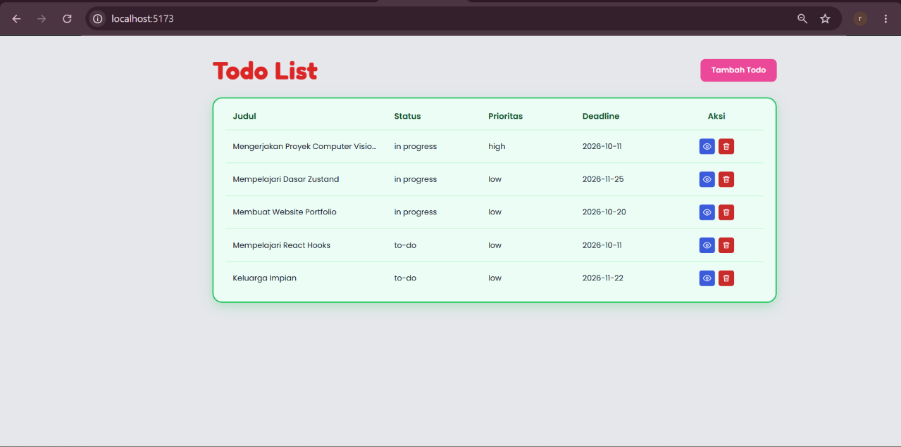
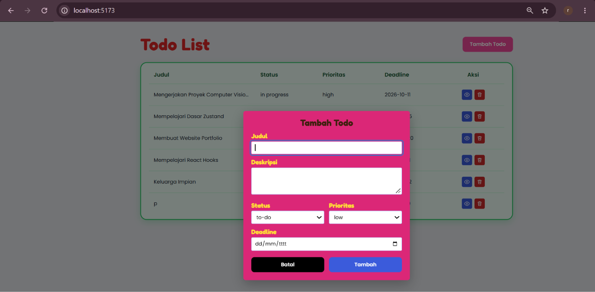
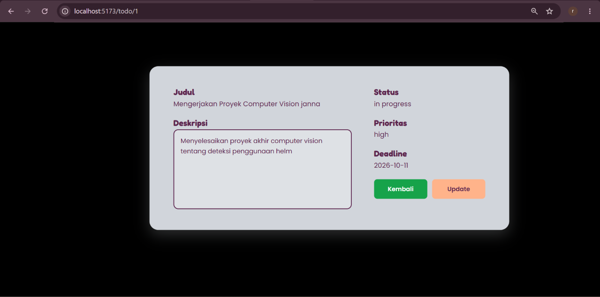
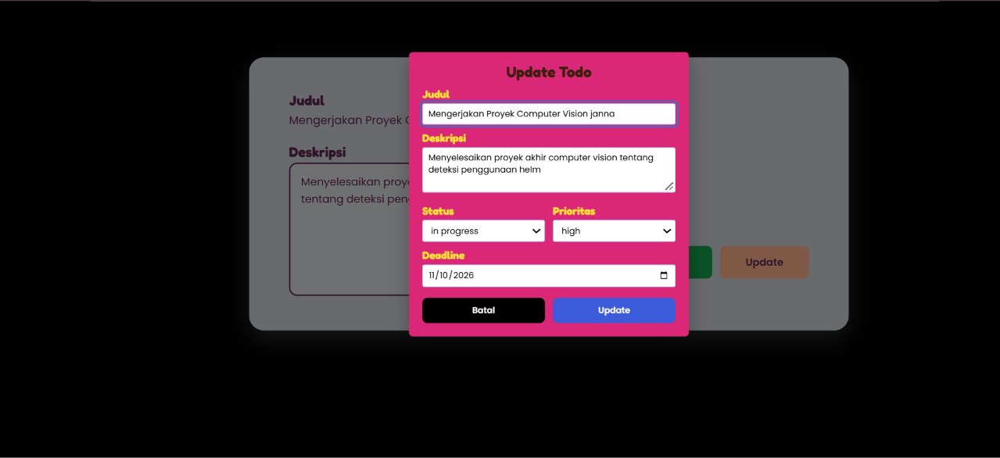

# Todo List – React.js

Aplikasi To-Do List frontend (React + Vite) dengan data dummy dan React State. Fitur: tampil daftar, lihat detail, tambah, update, dan hapus (dengan konfirmasi + notifikasi).

## Struktur Data
`{ id, title, description, priority, deadline, status }` — sama dengan atribut REST API (`/api/todos`), sehingga mudah diintegrasikan minggu depan.

## Menjalankan
```bash
npm install
npm run dev
```
Buka http://localhost:5173

## Screenshot
Tambahkan screenshot hasil di folder `screenshots/` lalu tampilkan di sini:





